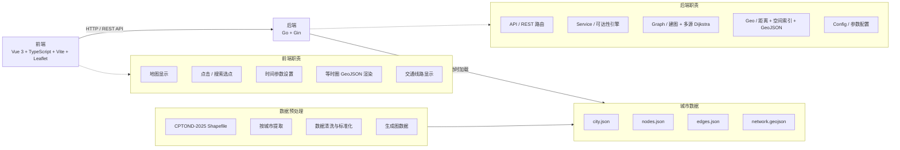
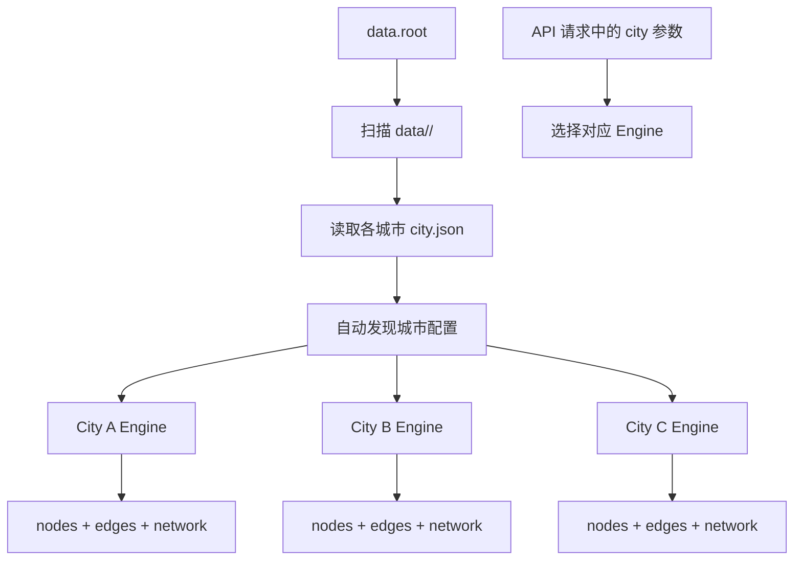
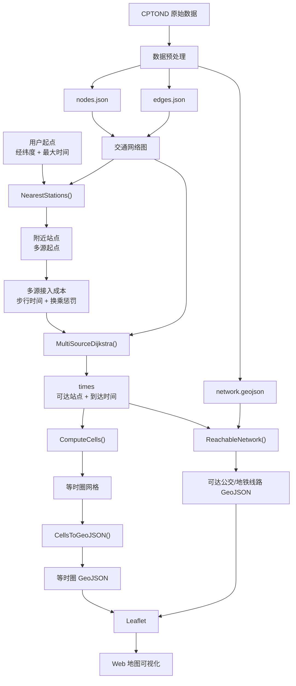

# 系统架构

## 职责划分

| 层              | 技术                | 职责                                                                  |
| --------------- | ------------------- | --------------------------------------------------------------------- |
| data-processing | Python + GeoPandas  | 读取 CPTOND Shapefile, 按指定城市提取和清洗数据,生成 nodes/edges JSON |
| backend         | Go + Gin            | 启动时加载图数据进内存;图算法、可达性计算、REST API、GeoJSON 输出     |
| frontend        | Vue3 + TS + Leaflet | 地图显示、选点交互、参数设置、结果渲染                                |

## 关键设计

- **图数据内存常驻**:启动时一次性加载,查询路径上无数据库/磁盘 IO
- **MySQL 不参与核心算法**:MVP 暂未接入;后续仅用于查询历史等业务数据
- **参数全部可配置**:`backend/config/config.json`,不写死在代码
- **TEST DATA 回退**:`data/` 下无真实数据时自动回退 `data/test/`(合成测试网络),
  API 与前端均明确标注 `testData=true`
- **单进程单二进制**:`backend/server.exe -config config/config.json`

## API 一览

| 方法 | 路径                                                           | 说明                                                                                                  |
| ---- | -------------------------------------------------------------- | ----------------------------------------------------------------------------------------------------- |
| GET  | /api/health                                                    | 健康检查(分城市返回节点/弧数、是否测试数据)                                                           |
| GET  | /api/cities                                                    | 当前支持的城市(code/name/bbox)                                                                        |
| GET  | /api/geocode?city=&q=                                          | 地址搜索(代理 Nominatim,限定城市 bbox;需网络,可配代理)                                                |
| GET  | /api/stations/nearby?city=&latitude=&longitude=&radius=&limit= | 附近站点(按距离排序)                                                                                  |
| POST | /api/isochrone                                                 | `{city?, latitude, longitude, maxTime, includeNetwork?}` → 可达区域 GeoJSON，可选返回可达交通线路网络 |

## 多城市架构(城市即配置)

- **数据目录按城市隔离**:`data/<city>/nodes.json + edges.json`
- **新增城市成本 = 一份预处理数据,无需修改配置**,预处理/建图/Dijkstra/等时圈代码零修改
- 后端启动时自动发现并逐城市加载独立 Engine; city 参数(请求体或 query)选择城市,缺省取自动发现列表中的第一个城市
- 业务代码无城市硬编码;坐标范围校验用各城市自身 bbox

### 跨城市通勤扩展预留(未启用,已有测试)

`service.LoadMerged(cfg, cities)` 可把多个城市合并进**同一张图**:

- 各城市数据使用本地 ID,合并时按城市做偏移重映射(ID 空间隔离问题已解决)
- `graph.Build` 不做任何"同城"假设——跨城市边(如佛山站→广州站的城际巴士边)
  与城内边完全同等处理,广州A→佛山Y 的 36 分钟路径已被单元测试验证
- 未来只需:① 预处理产出跨城市连接边; ② 在系统中增加跨城市数据合并配置,即可计算跨城等时圈
- 现在 buildEngine() 被 LoadMerged() 复用，所以刻意没有在那里加载 network.geojson。
  这意味着：
  单城市模式：Network 正常加载
  以后如果 LoadMerged() 真正启用跨城市：目前 Network == nil

## 数据流

